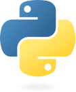



# 開発環境の構築について

## Pythonのインストールについて

GitHub CodeSpaceでは、デフォルトでPythonがインストールされています。

Pythonのバージョンは以下で確認できます。

```bash
python --version
```

## 仮想環境の準備

複数のアプケーションを開発している時にPythonのバージョンが衝突を起こさないようにするため、 `venv` というモジュールを使って仮想環境を構築します。

### 仮想環境の作成

仮想環境の作成には以下のコマンドを使用します。

```bash
python -m venv .venv
```

`python -m` はPythonのモジュールを実行するという意味です。（m = module）

`.venv` は仮想環境を作成するディレクトリ名です。慣例的に `.venv` という名前を使うことが多いです。\
コマンドを実行すると、ディレクトリ直下に `.venv` というディレクトリが作成されます。\
この中に仮想環境が入っています。

この時に仮想環境に作成されるPythonのバージョンは、コマンドを実行したPythonのバージョンと同じとなります。\
そのため、プロジェクトによって使用するPythonのバージョンが決められている場合、そのバージョンのPythonをインストールしてから仮想環境の作成を実行する必要があります。

### 仮想環境の有効化

仮想環境を使用する場合、環境を有効化する必要があります。\
有効化は以下のコマンドを実行します。

```bash
source .venv/bin/activate
```

有効化するとターミナルに `(.venv)` と表示されるようになります。
